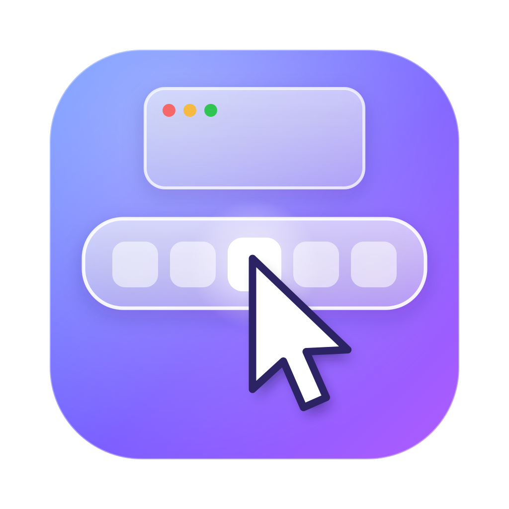

<p align="center"></p>

# RinDock

Bấm icon app trên Dock để **thu nhỏ**, bấm lại để **hiện lên**, giống taskbar trên Windows.

Mặc định macOS chỉ cho bấm Dock để mở app, bấm thêm lần nữa thì không có gì xảy ra. RinDock thêm phần còn thiếu đó. App nhỏ, miễn phí, mã nguồn mở, chạy trên thanh menu.

*English below.*

---

## RinDock làm gì

| Đang ở trạng thái | Bấm icon app trên Dock |
|---|---|
| App đang dùng, cửa sổ đang hiện | Thu nhỏ xuống Dock |
| Cửa sổ của app đang thu nhỏ hết | Hiện lại **tất cả** cửa sổ |
| App đang mở nhưng nằm phía sau | Đưa app lên trước (như bình thường) |

Trong menu RinDock trên thanh menu có 3 chế độ:

- **Thu nhỏ tất cả cửa sổ của app** (mặc định)
- **Chỉ thu nhỏ cửa sổ đang dùng**
- **Ẩn app**: nhanh, không có hiệu ứng thu nhỏ

Mẹo:

- Giữ **Command, Option, Control hoặc Shift** khi bấm thì Dock làm như bình thường.
- Kéo icon để sắp xếp Dock, nhấn giữ để mở menu icon: không bị ảnh hưởng.
- Nên bật thêm **System Settings → Desktop & Dock → Minimize windows into application icon** để cửa sổ thu nhỏ chui vào icon app, giống Windows hơn.

## Yêu cầu

- macOS 13 Ventura trở lên
- Mac chip Apple (M1, M2, M3, M4…) hoặc Mac Intel

---

## Cài đặt

### Cách 1: Tải app có sẵn (dễ nhất)

**Bước 1:** Vào mục [Releases](../../releases/latest), tải file `RinDock-x.x.dmg`.

**Bước 2:** Mở file `.dmg`, kéo icon **RinDock** sang thư mục **Applications** ngay bên cạnh. Kéo xong thì đẩy ổ RinDock ra (bấm nút ⏏ cạnh RinDock trong Finder).

**Bước 3:** Mở RinDock. Vì app chưa được Apple công chứng nên macOS sẽ chặn ở lần mở đầu, hộp thoại chỉ có 2 nút. Cách mở:

1. Bấm **Xong** (**Done**). ⚠️ **Đừng bấm Chuyển vào Thùng rác** (**Move to Trash**), bấm là app bị xoá.
2. Mở **Cài đặt hệ thống → Quyền riêng tư & Bảo mật** (**System Settings → Privacy & Security**).
3. Kéo xuống phần **Bảo mật** (**Security**), thấy dòng nói về RinDock thì bấm **Vẫn mở** (**Open Anyway**), nhập mật khẩu máy hoặc dùng Touch ID.
4. Hộp thoại hiện lại thì bấm **Vẫn mở** (**Open Anyway**).

Chỉ cần làm một lần. Các bản cập nhật sau RinDock tự cài, không bị chặn nữa.

**Bước 4:** Cấp quyền (xem phần [Cấp quyền](#cấp-quyền) bên dưới).

### Cách 2: Tự build từ mã nguồn

Không bị macOS chặn vì app được build ngay trên máy của bạn.

**Bước 1:** Mở **Terminal**, cài công cụ build của Apple (bỏ qua nếu đã có):

```bash
xcode-select --install
```

**Bước 2:** Tải mã nguồn và cài:

```bash
git clone https://github.com/PhuocRin/RinDock.git
cd RinDock
./build.sh install
```

App sẽ được chép vào **Applications** và tự mở lên.

---

## Cấp quyền

Lần đầu mở, RinDock hiện cửa sổ **Chào mừng** hướng dẫn từng bước: bấm **Mở cài đặt Accessibility**, bật công tắc cạnh RinDock là xong (cửa sổ tự hiện dấu ✓). Mở lại hướng dẫn bất cứ lúc nào: icon RinDock → **Hướng dẫn sử dụng**.

RinDock cần quyền **Accessibility** để biết bạn bấm icon nào trên Dock và thu nhỏ cửa sổ.

1. Lần đầu mở app, macOS sẽ hỏi. Bấm **Open System Settings**.
2. Vào **System Settings → Privacy & Security → Accessibility**.
3. Bật công tắc cạnh **RinDock**.

Icon RinDock trên thanh menu sáng lên là đã chạy.

**Mở cùng máy:** bấm icon RinDock trên thanh menu → tick **Mở cùng máy**.

## Cập nhật

RinDock tự cập nhật được, không cần tải lại từ GitHub. Bạn chọn cách bạn thích, ở menu RinDock hoặc trong cửa sổ **Kiểm tra cập nhật…**:

**Tự kiểm tra cập nhật:** Mỗi ngày (mặc định) · Mỗi tuần · Tắt

**Khi có bản mới:**
- **Tự cập nhật**: RinDock tự tải, kiểm tra chữ ký, cài và mở lại.
- **Hỏi trước khi cập nhật** (mặc định): hiện cửa sổ hỏi, bấm **Cập nhật ngay** là xong.
- **Chỉ báo cho tôi**: icon trên thanh menu thêm dấu chấm, bạn cập nhật khi muốn.

Muốn kiểm tra ngay: bấm icon RinDock → **Kiểm tra cập nhật…**.

Lưu ý:
- Tự cập nhật chỉ chạy khi RinDock nằm trong thư mục **Applications**.
- Mọi bản cập nhật đều được ký số. RinDock kiểm tra chữ ký trước khi cài, sai chữ ký là không cài.
- Bản cập nhật giữ nguyên quyền Accessibility, bạn không phải cấp lại.

## Giao diện kính

Icon RinDock → **Giao diện kính…**:
- **Kiểu kính:** Theo hệ thống (theo cài đặt Liquid Glass của macOS) · Trong · Mờ. Cần macOS 26.1 trở lên.
- **Độ đậm của nền:** kéo về Trong để nhìn xuyên ra màn hình phía sau, kéo về Đậm cho dễ đọc.

## Ngôn ngữ

RinDock có tiếng Việt và tiếng Anh. Đổi ở: icon RinDock trên thanh menu → **Ngôn ngữ · Language** → **Tiếng Việt**, **English** hoặc **Theo ngôn ngữ của máy**.

## RinDock có an toàn không?

- RinDock **không** chụp màn hình, **không** ghi lại thao tác bàn phím.
- Quyền Accessibility chỉ dùng để đọc icon Dock dưới con trỏ và thu nhỏ / hiện cửa sổ.
- Kết nối mạng duy nhất: hỏi GitHub có bản mới không (mỗi ngày, mỗi tuần, hoặc tắt), và tải bản mới khi cập nhật. Không gửi thông tin gì của bạn.
- Bản cập nhật được ký số; RinDock chỉ cài khi chữ ký đúng là của tác giả.
- Khi bạn bấm **Báo lỗi**, app chỉ mở email hoặc GitHub có điền sẵn phiên bản app, macOS, loại chip và nhật ký 30 lần bấm Dock gần nhất (tên app được bấm, chỉ lưu trong bộ nhớ, thoát app là mất). Bạn xem được hết trước khi gửi, không gửi thì không có gì đi đâu cả.
- Toàn bộ mã nguồn nằm trong một file: [`Sources/main.swift`](Sources/main.swift). Bạn có thể đọc trước khi cài.

## Gặp lỗi?

Bấm icon RinDock trên thanh menu → **Báo lỗi…** → chọn **Gửi qua email** hoặc **Báo trên GitHub**. Mô tả lỗi giúp mình nha.

**RinDock không làm gì khi bấm Dock**
Vào **System Settings → Privacy & Security → Accessibility**, chọn RinDock, bấm nút **−** để xoá, rồi mở lại RinDock và cấp quyền lại. Hay gặp khi chuyển từ bản thử cũ sang bản mới.

**Một app nào đó không thu nhỏ được**
Một số app khai báo cửa sổ theo kiểu riêng nên RinDock không nhận ra. Hãy mở [Issue](../../issues) kèm tên app.

## Gỡ cài đặt

1. Bấm icon RinDock trên thanh menu → **Thoát RinDock**.
2. Xoá **RinDock.app** trong **Applications**.
3. Vào **System Settings → Privacy & Security → Accessibility**, xoá RinDock khỏi danh sách.

---

## Ủng hộ tác giả

RinDock miễn phí và sẽ luôn miễn phí. Nếu app giúp ích cho bạn, bạn có thể ủng hộ tác giả ngay trong app: bấm icon RinDock trên thanh menu → **♥ Ủng hộ tác giả…**

Hoặc ủng hộ qua [PayPal.me/phuocrin](https://paypal.me/phuocrin).

Không ủng hộ cũng không sao. Bấm ⭐ cho repo, hoặc chia sẻ RinDock cho bạn bè dùng Mac là mình vui rồi.

---

## English

**RinDock** makes the macOS Dock behave like the Windows taskbar: click the icon of the app you're using to minimize it, click again to bring all its windows back. Free, open source, lives in the menu bar.

**Requirements:** macOS 13 or later, Apple silicon or Intel.

**Install (pre-built):** download `RinDock-x.x.dmg` from [Releases](../../releases/latest), open it, drag **RinDock** onto **Applications**, then open the app. The app isn't notarized, so the first launch is blocked: click **Done** (not **Move to Trash**), go to **System Settings → Privacy & Security**, scroll to **Security**, click **Open Anyway**, then confirm **Open Anyway** again.

**Install (from source):**

```bash
xcode-select --install
git clone https://github.com/PhuocRin/RinDock.git
cd RinDock
./build.sh install
```

**Permission:** grant Accessibility in **System Settings → Privacy & Security → Accessibility**. RinDock uses it only to detect Dock clicks and minimize or restore windows. No screen recording, no keylogging. Network use: checking GitHub for a new version (daily, weekly or off) and downloading it when updating; nothing about you is sent.

**Language:** menu bar icon → **Ngôn ngữ · Language** → **English**. All menus and windows switch to English.

**Updates:** RinDock updates itself. Choose how often it checks (daily, weekly, off) and what happens when an update is out (install automatically, ask first, or just notify). Every update is signed and verified before installing, and Accessibility permission is kept across updates. Self-update works when RinDock is in the Applications folder.

**Bug reports:** menu bar icon → **Report a Bug…** (email or GitHub issue, prefilled with app version, macOS version and chip).

**Modes (menu bar):** minimize all windows (default), minimize the focused window, or hide the app. Hold ⌘, ⌥, ⌃ or ⇧ while clicking to get the normal Dock behavior.

**Support the author:** RinDock is free. You can support me from the app (menu bar icon → **♥ Support the Author…**) or via [PayPal.me/phuocrin](https://paypal.me/phuocrin). A ⭐ on the repo helps too.

---

## Tác giả

Làm bởi **Phước Rin**: [YouTube](https://youtube.com/@phuocrin) · [TikTok](https://www.tiktok.com/@phuocrinrin) · [beacons.ai/phuocrin](https://beacons.ai/phuocrin)

Giấy phép [MIT](LICENSE).
